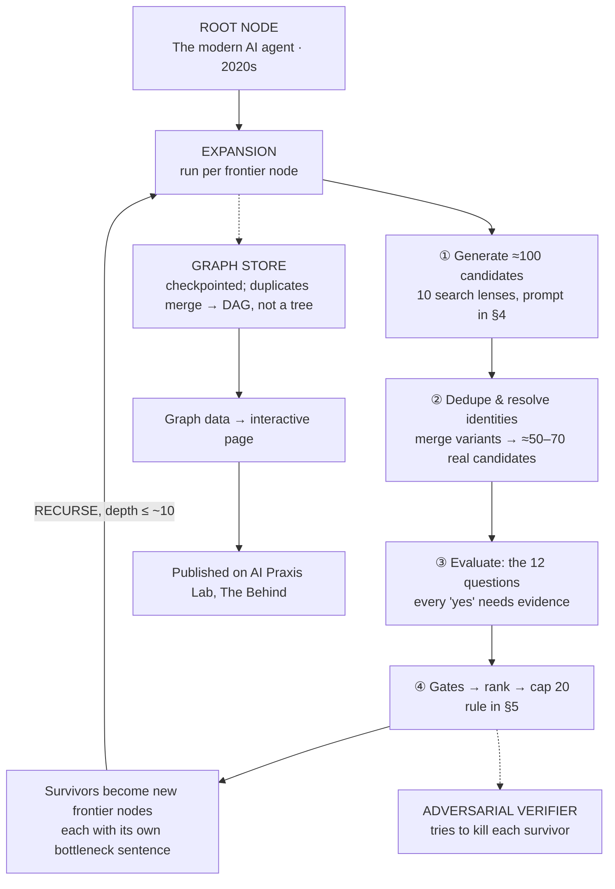

# Tracing the Milestones: A Recursive Pipeline from the AI Agent Backwards

**The Behind · 01 · Design v2 · 2026-11-24**

## §0 The idea in one paragraph

Start from a single node, the modern AI agent. Ask: what had to exist before this became possible? Generate about 100 candidate predecessors, interrogate every candidate with 12 fixed questions, prune hard to at most 20 survivors, and recurse on each survivor. Because the same predecessor (electricity, calculus, the transistor) is reached from many children, the result is not a tree but a merged graph (a DAG) of the breakthroughs that made the agent possible, each admitted only after passing the same interrogation, each carrying its evidence. The graph then becomes an interactive page on AI Praxis Lab (The Behind) that readers can explore node by node.

## §1 The process



**Flow, in words:**

- **ROOT NODE** (The modern AI agent · 2020s)
- → one expansion box run per frontier node with four steps:
  1. Generate ≈100 candidates (10 search lenses, prompt in §4)
  2. Dedupe & resolve identities (merge variants → ≈50–70 real candidates)
  3. Evaluate: the 12 questions (every "yes" needs evidence)
  4. Gates → rank → cap 20 (rule in §5)
- Survivors become new frontier nodes, each with its own bottleneck sentence; loop labeled "RECURSE, depth ≤ ~10".
- Side boxes: **GRAPH STORE** (checkpointed; duplicates merge → DAG, not a tree) and **ADVERSARIAL VERIFIER** (tries to kill each survivor).
- Output: graph data → interactive page → published on AI Praxis Lab, The Behind.

Two structural choices keep a day-long run sane: **merging** (one transistor node with five edges, not five copies; merging is decided by the identity machinery of §4.5, not by name matching) and **checkpointing** (every finished expansion is written to the graph store immediately; the run can pause, be inspected, and resume).

## §2 Node and edge format

Every node = one breakthrough + one bottleneck sentence of the form "Before X, Y was impossible or impractical because Z."

Every edge reads "enabled by": the child node's bottleneck was removed by the parent advance.

**Root node:**

- **Name:** "The modern AI agent"
- **Era:** 2020s
- **Bottleneck sentence:** "Before the modern AI agent, machines could not perceive, reason over, and act on open-ended tasks in a loop, because no model could flexibly convert between language, perception and action, and there was no practical way to train or steer such a model."

**Node record fields:** canonical name, approx. year, domain, type, bottleneck sentence, status (provisional / verified), the 12 verdicts with evidence, source list.

## §3 The 12 questions

Every candidate is interrogated with the same 12 questions, always in relation to the parent node it claims to enable. Mutually exclusive (each owns one dimension), collectively exhaustive. Q5 (scale ceiling) and Q8 (controllability) from the earlier 14-question draft were removed on 2026-11-24 as the two weakest.

| # | Dimension | Question | Literature anchor |
|---|---|---|---|
| Q1 | Impossibility flip | "Before this, was there a specific problem that could not be solved at all, and did this make it solvable?" | Rosenberg, bottlenecks as focusing devices (1976/1982) |
| Q2 | Generativity | "Did this unblock a whole space of previously impossible things, not just one problem?" | Bresnahan & Trajtenberg (1995), "innovational complementarities"; GPTs as "enabling technologies" |
| Q3 | Necessity | "For the node it feeds, was this the only path through, or could that node have emerged another way?" | Ogburn & Thomas (1922); Merton (1961), multiples vs singletons |
| Q4 | Cost collapse | "Did it drop the cost, time, or effort of something by orders of magnitude, making the impractical routine?" | Nordhaus (2007); Wright's law / learning curves |
| Q5 | Measurability | "Did it make something previously unobservable into something measurable?" | Hacking (1983); Galison (1997), instruments create observables |
| Q6 | Understanding | "Did it supply a new explanatory model, so people could design deliberately instead of by trial and error?" | Mokyr (2002), propositional vs prescriptive knowledge |
| Q7 | Composability | "Did it create a standard, interface, or abstraction others could build on without understanding its internals?" | Baldwin & Clark (2000), modularity |
| Q8 | Cross-domain reach | "Did it unlock progress in fields beyond the one it was created for?" | Bresnahan & Trajtenberg (1995), "pervasiveness"; Johnson (2014), hummingbird effect |
| Q9 | Iteration speed | "Did it collapse the experiment feedback loop, making the next try dramatically faster?" | Thomke (2003), experimentation cost |
| Q10 | Displacement | "Did it replace the incumbent default, so the old way stopped being the standard path?" | Kuhn (1962); Funk & Owen-Smith (2017), disruption index |
| Q11 | Lineage centrality | "In the history that actually happened, is this a trunk node or a side branch?" | Wu, Wang & Evans, Nature (2019), CD index at scale |
| Q12 | Irreversibility | "Once it existed, could the field ever go back, or did it permanently reset the baseline?" | David (1985); Arthur (1989), path dependence and lock-in |

> **Note:** the 12-as-a-set being mutually exclusive and exhaustive is our synthesis; the backing is per question, which is how the design documents it.

## §4 Candidate generation

Scoring is strict, so generation must be loose. The scout prompt is deliberately forbidden from judging importance: its job is to over-propose roughly 100 dated, named candidates with a causal claim each, and let the 12 questions do the filtering. One run of this prompt happens per frontier node. It is a fan-out: ten lenses, each a separate search pass with its own query templates, each expected to return about ten candidates.

### 4.1 Inputs

Slots filled per node:

- `{parent_name}`
- `{parent_year}` (hard upper bound — every candidate must be earlier)
- `{parent_domain}`
- `{bottleneck_statement}`
- `{existing_nodes}` (canonical names already in the graph, attached so the scout reuses exact names — this is what lets the graph merge)
- `{already_rejected}` (candidates previously evaluated and rejected for this parent — never re-propose)

### 4.2 The ten lenses

| # | Lens | What it looks for | Example query templates |
|---|---|---|---|
| 1 | Bottleneck-direct | ask the bottleneck question head-on | "what made {capability} possible" · "history of {domain}" · "{parent} prerequisites" · "why was {parent} impossible before {parent_year}" |
| 2 | Components | decompose the parent into subsystems; one search per subsystem | "history of {subsystem}" · "{subsystem} invention" · "first practical {subsystem}" |
| 3 | Underlying science | theories and discoveries the parent silently rests on | "{parent} scientific basis" · "discovery that enabled {domain}" |
| 4 | Instruments | tools needed to observe, measure, build or test it | "instruments used in early {domain}" · "how was {quantity} first measured" |
| 5 | Materials | materials that had to exist, be purified, or be manufacturable | "{material} production history" · "history of {material} purification" |
| 6 | Mathematics | formalisms, notation, algorithms that had to exist first | "mathematics behind {parent}" · "history of {formalism}" |
| 7 | Infrastructure | energy, transport, communication, manufacturing base it assumes | "what infrastructure did {domain} depend on" |
| 8 | Cross-domain transfer | advances imported from unrelated fields | "{technique} applied to {domain} history" · "{parent} borrowed from which field" |
| 9 | Methods | process innovations: machining, printing, lens grinding, sterilization… | "process that made {parent} manufacturable" · "history of {process}" |
| 10 | Timelines | reference works and surveys that already list the chain | "timeline of {domain}" · encyclopedia / survey history of {domain} |

### 4.3 The scout prompt template

```
ROLE
You are the candidate scout for a recursive history-of-technology trace.
Your job is breadth, not judgment. A later stage will interrogate every
candidate with 12 fixed questions and prune hard. If you pre-filter by
importance, the trace loses exactly the candidates that matter most.
Over-propose.

PARENT NODE
Name: {parent_name}
Year: {parent_year}  (hard upper bound: every candidate must be earlier)
Domain: {parent_domain}
Bottleneck this node removed: {bottleneck_statement}
Read it as: "Before {parent_name}, {capability} was impossible or
impractical because {constraint}."

TASK
Find approximately 100 earlier advances that plausibly removed part of
that bottleneck, or were necessary preconditions for {parent_name}.
Work through all 10 search lenses (attached). Run real web searches for
each lens, at least 2 query variants per lens, and read the strongest
sources, preferring reference works, textbooks, and scholarly histories
over popular listicles.

RULES
- Dated and named. Every candidate is a specific advance with an
  approximate year. Era-words are banned: not "electricity" but
  "Gramme dynamo (1871)"; not "computers" but "stored-program
  architecture (1945)".
- Causal claim required. One sentence: "{candidate} made {parent_name}
  possible by ..." If you cannot write that sentence, drop the candidate.
- Reuse canonical names. If a candidate matches a node in EXISTING
  NODES (attached), use that exact name. This is what lets the graph merge.
- Never re-propose anything in ALREADY REJECTED (attached).
- Borderline is fine. Duplicates across lenses are fine; dedupe comes
  later. Importance filtering is NOT your job.

OUTPUT
A JSON array only, one object per candidate:
{"name": "...", "year": 1871, "domain": "...", "lens": "instruments",
 "causal_claim": "...", "source_title": "...", "source_url": "..."}
```

### 4.4 Dedupe

A resolver pass merges name variants of the same advance, maps matches onto existing graph nodes, drops anything dated on or after the parent, and drops exact repeats of rejected candidates. Typical yield: 100 raw → 50–70 distinct candidates. Dedupe is the candidate-scale application of the identity machinery in §4.5.

### 4.5 Node identity: deciding two candidates are the same node

Convergence is the whole point of the graph, and keyword matching cannot carry it. The same advance arrives under many names ('Gramme dynamo', 'dynamo', 'self-excited dynamo', 'electric generator'), and near-identical names can be different advances ('dynamo' vs 'alternator'; 'gradient descent' vs 'backpropagation'). Exact-match merging misses true merges, so branches never visibly converge, and risks false merges, collapsing two technologies into one node and corrupting every edge and verdict downstream. Identity is therefore decided by layered signals, never by the name string alone.

#### A. The identity card

Similarity is never computed on the name alone. Every candidate and node carries an identity card: canonical name, alias list, approximate year, domain, type (device / theory / method / material / institution), and a one-sentence definition of what it is and what it enabled. Every signal below reads the card, not the keyword.

#### B. Four signals, in order

1. **Canonical ID match (strongest).** Link the candidate to a reference identity: a Wikidata QID where one exists, otherwise the standard reference-work title (e.g. the Wikipedia article title, whose redirect list doubles as an alias source). Same QID = same node, full stop. This resolves most well-documented historical advances exactly.
2. **Alias and normalization match.** Normalized name (case, punctuation, word order, person-name variants) checked against the node's alias table, which grows with every confirmed merge.
3. **Embedding similarity (vector search).** Embed the identity-card text (name + definition sentence) with a standard text-embedding model and compare by cosine similarity against all existing node cards, retrieved through a small vector index (FAISS or sqlite-vec; at roughly 2,000 nodes this takes milliseconds). Bands: 0.92 and above = strong same-node candidate; 0.80 to 0.92 = gray zone, sent to the judge; below 0.80 = treated as different. Thresholds are starting values, calibrated against the run's own merge log.
4. **Hard vetoes (override any text similarity).** A year gap over about 25 years means not the same event. Different types never merge: a person is not a device, a theory is not a material. An incompatible causal role for the parent in question also vetoes.

#### C. The gray zone goes to a judge

Pairs in the middle band, and any pair a veto flags as suspicious, go to an adjudication step with three outcomes, not two: SAME (merge), DIFFERENT (keep both), or SUBTYPE (one is a specific instance of the other: keep the specific node, record the general term as a related concept, do not merge; 'Gramme dynamo' is a subtype of 'dynamo', not a synonym). The judge sees both identity cards and the sources behind them and must state its reason in one sentence, which is written to the merge log.

#### D. Merge mechanics and the safety bias

Merging is union-find over canonical nodes. The surviving node keeps the most standard name, unions the alias lists and the edge sets, and keeps the earliest defensible year. Every merge is written to a merge log (which nodes merged, which signals fired, the similarity scores, the judge's sentence), and merges are reversible: an unmerge restores both nodes and their original edges. The bias throughout is precision over recall: a false split is cheap, because the verifier can merge later, while a false merge is expensive, because it silently rewrites history. Every threshold therefore errs toward 'different'.

#### E. Where it runs

Three places:

- (a) inside each expansion, clustering the roughly 100 raw candidates before evaluation, which is what §4.4's dedupe actually is;
- (b) at graph insertion, matching each survivor against all existing nodes, which is the moment convergence actually happens;
- (c) as a verifier duty: sample already-merged nodes and re-run the judge with fresh eyes (a split check).

**Payoff:** The payoff: convergence becomes measurable. A node's in-degree, how many independent branches converged on it, is direct evidence for Q11 (lineage centrality). Trunk nodes identify themselves.

## §5 Evaluation and pruning

**Evaluation contract:** the evaluator receives one candidate + the parent node + the causal claim, and must answer all 12 questions with verdicts pass / partial / fail. Every "pass" requires (a) a short evidence quote, (b) a source, (c) a falsification note: "this pass dies if …". No evidence, no pass.

> **Gates:** A candidate survives only if Q1 **OR** Q2 passes (it flipped an impossibility for this child, or opened the space) **AND** Q3 is not a clear fail (not demonstrably substitutable).

Survivors are ranked by their score across the remaining nine questions and capped at 20 per parent node. Everything else is recorded as rejected-with-reason (rejections are data: they feed the `{already_rejected}` list and keep later rounds honest).

## §6 Adversarial verification

Survivors get a second, hostile pass. The verifier's job is to kill the node: attack Q1 (was it truly impossible before, or merely hard, expensive, or unfashionable?); attack Q3 with the multiples test (search for independent simultaneous discoverers — if two others did it in the same decade, necessity is downgraded to "ripe"); check the date and the causal direction. Nodes that survive are marked verified; the rest stay provisional, and the interactive page shows the distinction.

## §7 Budgets and stop conditions

| Item | Value |
|---|---|
| Per parent node | ≈100 raw candidates → cap 20 survivors |
| Depth cap | ~10 |
| Global node budget for the day run | ~2,000 nodes (checkpointed; if the budget ends the run early, the graph is still complete and publishable as-is) |

A node stops expanding when:

- fewer than 5 candidates pass the gates, OR
- its candidate pool falls before ~1500 where the written record thins out, OR
- it duplicates an already-expanded node.

**Frontier control:** if the frontier exceeds the per-depth budget, expand highest-scoring nodes first (best-first, not breadth-first).

## §8 Worked example

The root's first round, illustrative:

**Parent:** The modern AI agent (2020s).

A few of the ~100 the scout should find, by lens:

- **Components** — Transformer architecture (2017); Backpropagation popularized (1986).
- **Infrastructure** — CUDA / GPGPU computing (2007); the web as a text corpus (1990s).
- **Instruments** — ImageNet (2009), the dataset as measuring instrument.
- **Methods** — RLHF (2022), teaching a model to follow instructions.
- **Mathematics** — Stochastic gradient descent; information theory (1948).
- **Underlying science** — the connectionist program / perceptron (1958).

Then each of these faces the same 12 questions against the root, the gates, and the cap of 20, and each survivor (say, the Transformer) becomes a parent: "Before the Transformer, sequence models could not attend over long contexts in parallel because recurrence forced serial computation…" and the recursion walks back.

## §9 Output and the interactive page

The run emits one graph file: nodes, edges, per-node verdicts and evidence. The page renders it as an explorable tree/DAG: click a node → its bottleneck sentence, its 12-question verdict table, its sources, its verified/provisional status; expand/collapse branches; a timeline mode laying nodes out by year so readers watch the chain converge backwards. Built first as a standalone page for owner review, then integrated into AI Praxis Lab as a The Behind piece.

## §10 What happens next

1. Owner approves this design (one open item at design time: the gate rule in §5 — subsequently approved 2026-11-24).
2. The design replaces the old question grammar in the llm-wiki design page, with the §3 literature anchors added.
3. The Batch 0 harness is adjusted to this spec (in this repo, that harness is RUNBOOK.md + pipeline/).
4. The day-long run starts from the root.
5. The interactive page is generated from the resulting graph and placed on AI Praxis Lab.

---

*The Behind 01 · Design v2 · Prepared for Jerry Yu · 2026-11-24.*
