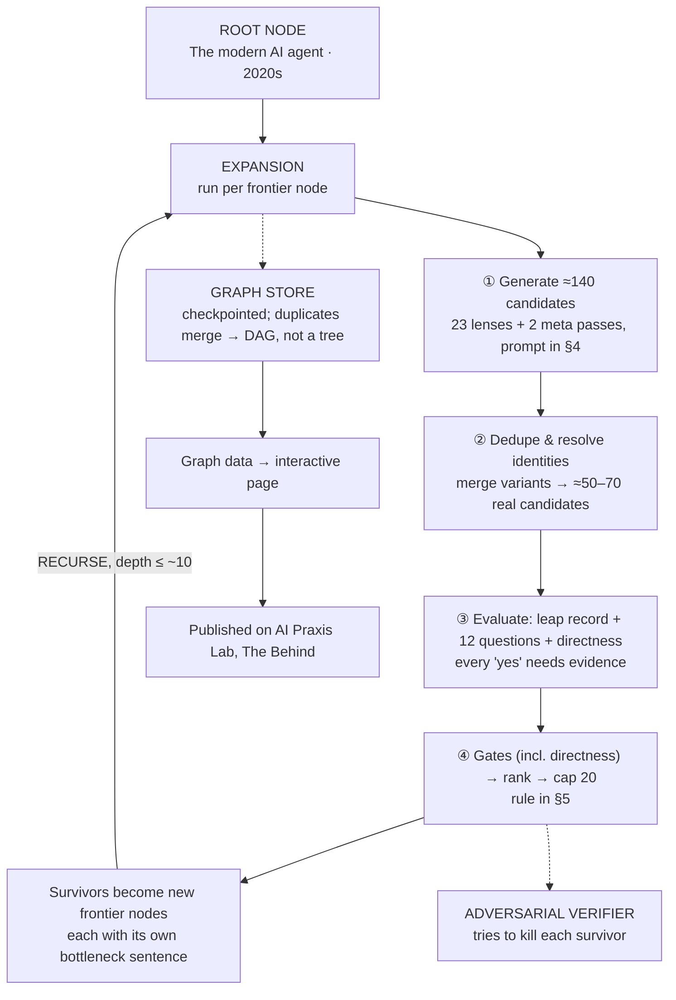

# Tracing the Milestones: A Recursive Pipeline from the AI Agent Backwards

**The Behind · 01 · Design v4 · 2026-11-24**

## §0 The idea in one paragraph

Start from a single node, the modern AI agent. Ask: what appeared shortly before it that directly made its leap possible? Generate about 140 candidate proximate predecessors, interrogate every candidate with 12 fixed questions plus a directness gate, prune hard to at most 20 survivors, and recurse on each survivor. Every node is a **leap**: a discontinuous, widely recognized improvement over the state of the art immediately before it. Every edge means the predecessor was the **direct enabler of that leap** — not a mediated ancestor. This matters because importance is transitive but directness is not: a deep fundamental (gradient descent, electricity, calculus) genuinely matters to everything downstream, yet it reaches any given node only through intermediaries, so it must surface at the depth where it was the proximate enabler, not at depth 1. Because the same predecessor is reached from many children, the result is not a tree but a merged graph (a DAG) of the breakthroughs that made the agent possible, each admitted only after passing the same interrogation, each carrying its evidence. The graph then becomes an interactive page on AI Praxis Lab (The Behind) that readers can explore node by node.

## §1 The process



**Flow, in words:**

- **ROOT NODE** (The modern AI agent · 2020s)
- → one expansion box run per frontier node with four steps:
  1. Generate ≈140 proximate candidates (23 lenses + 2 meta passes, prompt in §4)
  2. Dedupe & resolve identities (merge variants → ≈85–100 real candidates)
  3. Evaluate: the parent's leap record, the 12 questions, and the directness test (every "yes" needs evidence)
  4. Gates (question gates + the directness gate) → rank → cap 20 (rule in §5)
- Survivors become new frontier nodes, each with its own bottleneck sentence; loop labeled "RECURSE, depth ≤ ~10".
- Side boxes: **GRAPH STORE** (checkpointed; duplicates merge → DAG, not a tree) and **ADVERSARIAL VERIFIER** (tries to kill each survivor).
- Output: graph data → interactive page → published on AI Praxis Lab, The Behind.

Two structural choices keep a day-long run sane: **merging** (one transistor node with five edges, not five copies; merging is decided by the identity machinery of §4.5, not by name matching) and **checkpointing** (every finished expansion is written to the graph store immediately; the run can pause, be inspected, and resume).

## §2 Node and edge format

Every node = one breakthrough + one bottleneck sentence of the form "Before X, Y was impossible or impractical because Z." Every node is also a **leap** (§5.1): it carries a record of the state of the art immediately before it and what discontinuously jumped when it appeared.

Every edge reads "enabled by" — and since v3 that phrase is strict: the predecessor **directly enabled the child node's leap**. A mediated ancestor, however important, is not an edge at this level; it is rejected with the mediator named (`mediated_via: M`) and is expected to be rediscovered when M itself is expanded.

**Root node:**

- **Name:** "The modern AI agent"
- **Era:** 2020s
- **Bottleneck sentence:** "Before the modern AI agent, machines could not perceive, reason over, and act on open-ended tasks in a loop, because no model could flexibly convert between language, perception and action, and there was no practical way to train or steer such a model."
- **State of the art just before:** chatbots and task-specific ML systems — models could complete text or classify inputs, but could not follow open-ended instructions reliably, use external tools, or chain reasoning and action toward a goal.
- **The leap:** instruction-following LLMs wrapped in a reason–act loop with tool use (2022–23) turned a text completer into a general task executor — a capability jump, not an incremental accuracy gain.

**Node record fields:** canonical name, approx. year, domain, type, bottleneck sentence, prior-state sentence, leap sentence, status (provisional / verified), source list.

**Edge record fields:** the 12 verdicts with evidence (of the predecessor, in relation to the child), the **leap record** (prior state / what jumped / the child's date, with evidence), and the **directness record** (counterfactual argument, mediator — null for admitted edges, evidence).

## §3 The 12 questions

Every candidate is interrogated with the same 12 questions, always in relation to the parent node it claims to enable. Mutually exclusive (each owns one dimension), collectively exhaustive. Q5 (scale ceiling) and Q8 (controllability) from the earlier 14-question draft were removed on 2026-11-24 as the two weakest.

| # | Dimension | Question | Literature anchor |
|---|---|---|---|
| Q1 | Impossibility flip | "Before this, was there a specific problem that could not be solved at all, and did this make it solvable?" | Rosenberg, bottlenecks as focusing devices (1976/1982) |
| Q2 | Generativity | "Did this unblock a whole space of previously impossible things, not just one problem?" | Bresnahan & Trajtenberg (1995), "innovational complementarities"; GPTs as "enabling technologies" |
| Q3 | Necessity | "For the node it feeds, was this the only path through, or could that node have emerged another way?" | Ogburn & Thomas (1922); Merton (1961), multiples vs singletons |
| Q4 | Cost collapse | "Did it drop the cost, time, or effort of something by orders of magnitude, making the impractical routine?" | Nordhaus (2007); Wright's law / learning curves |
| Q5 | Measurability | "Did it make something previously unobservable into something measurable?" | Hacking (1983); Galison (1997), instruments create observables |
| Q6 | Understanding | "Did it supply a new explanatory model, so people could design deliberately instead of by trial and error?" | Mokyr (2002), propositional vs prescriptive knowledge |
| Q7 | Composability | "Did it create a standard, interface, or abstraction others could build on without understanding its internals?" | Baldwin & Clark (2000), modularity |
| Q8 | Cross-domain reach | "Did it unlock progress in fields beyond the one it was created for?" | Bresnahan & Trajtenberg (1995), "pervasiveness"; Johnson (2014), hummingbird effect |
| Q9 | Iteration speed | "Did it collapse the experiment feedback loop, making the next try dramatically faster?" | Thomke (2003), experimentation cost |
| Q10 | Displacement | "Did it replace the incumbent default, so the old way stopped being the standard path?" | Kuhn (1962); Funk & Owen-Smith (2017), disruption index |
| Q11 | Lineage centrality | "In the history that actually happened, is this a trunk node or a side branch?" | Wu, Wang & Evans, Nature (2019), CD index at scale |
| Q12 | Irreversibility | "Once it existed, could the field ever go back, or did it permanently reset the baseline?" | David (1985); Arthur (1989), path dependence and lock-in |

> **Note:** the 12-as-a-set being mutually exclusive and exhaustive is our synthesis; the backing is per question, which is how the design documents it.

## §4 Candidate generation

Scoring is strict, so generation must be loose — but, since v3, loose in one direction only: **backwards by a single step**. The scout is forbidden from judging importance, and equally forbidden from trawling deep history: its job is to over-propose roughly 140 dated, named candidates that appeared shortly before the parent and plausibly enabled the parent's leap *directly*, each with a causal claim, and let the 12 questions and the directness gate do the filtering. Time is a first-class dimension: every search is anchored in the parent's immediate pre-history — the state of the art just before it, the systems it was compared against, and contemporaneous accounts of why it jumped. Distant fundamentals are explicitly out of scope at this level; they belong to deeper expansions. One run of this prompt happens per frontier node. It is a fan-out: 23 lenses in 6 families plus 2 source-genre meta passes (§4.2), each lens a separate search pass with its own query templates. Every content lens is mandatory for every parent and must return at least 3 candidates or a recorded dry note — coverage is auditable per expansion, not assumed.

### 4.1 Inputs

Slots filled per node:

- `{parent_name}`
- `{parent_year}` (hard upper bound — every candidate must be earlier)
- `{parent_domain}`
- `{bottleneck_statement}`
- `{immediate_prior_state}` (the state of the art just before the parent appeared — what the best existing approach could and could not do)
- `{parent_leap}` (what discontinuously jumped when the parent appeared)
- `{existing_nodes}` (canonical names already in the graph, attached so the scout reuses exact names — this is what lets the graph merge)
- `{already_rejected}` (candidates previously evaluated and rejected for this parent, including any rejected as mediated — never re-propose)

### 4.2 The lens framework (v4): derived, not listed

A lens is not a topic. A lens is a *question the scout must answer about the parent*, phrased in the vocabulary in which that kind of answer is documented. The v4 lens set is **generated** from a decomposition of the problem, so that coverage can be argued, audited, and falsified. The v3 list (10 lenses, written ad hoc) and the v3.1 patch (+2, after the hardware/data blindness) had no closure property: a list built by brainstorming admits no argument about what it does *not* contain, and the hardware/data miss was the proof — the miss was not a scout's carelessness, it was a question nobody's lens asked. (Full derivation, validation, and old→new mapping: `LENS-FRAMEWORK-DESIGN.md`, approved by the owner 2026-11-24.)

**Method.** A candidate is a direct enabler of the parent's leap. Any such enabler, whatever it is, must satisfy three things: (1) it is **some kind of thing** — a category of entity that can come into existence or change; (2) it stands in **some causal relation** to the parent — a specific way in which it enabled; (3) it **changed before the leap** — the trace's standing precondition (proximate, dated, earlier), not an axis. The framework is the cross-product of (1) and (2), pruned by reality. Lenses are defined at the granularity where *search behaviour* differs: cells that share a lens share query vocabulary. (One lens per cell would multiply near-identical searches; one lens per kind — the v3.1 failure mode — merges questions with different vocabularies into a grab-bag. Old lens 7, "infrastructure at hand", was exactly that failure.)

#### 4.2.1 Axis 1 — the enabler ontology (what kinds of things can enable a leap)

A leap is a discontinuity in what a practice can do. For the leap to happen, something in the world must have become different. The stocks that can change:

| Code | Kind | The change that enables sounds like… | Examples |
|---|---|---|---|
| K1 | **Theory & explanatory knowledge** | "we now know / can prove / understand that…" | theorems, laws, statistical models, obstruction analyses |
| K2 | **Methods, algorithms & recipes** | "we now have a procedure for…" | algorithms, training recipes, protocols, prompting patterns |
| K3 | **Architectures & components** | "there is now a design / part that…" | mechanisms, modules, system architectures |
| K4 | **Data & corpora** | "there now exist records of…" | datasets, corpora, curated collections, data pipelines |
| K5 | **Machines & devices** | "there is now physical plant that can…" | processors, accelerators, clusters, end devices, lab machines |
| K6 | **Software & platforms** | "there is now code / a service that…" | libraries, frameworks, APIs, hosted services, programmability layers |
| K7 | **Instruments, metrics & evaluation schemes** | "we can now see / measure / compare…" | sensors, instruments, metrics, benchmarks-as-tests |
| K8 | **Standards & interfaces** | "there is now an agreed spec for…" | file formats, protocols, interface specifications, standard dimensions |
| K9 | **Problem formulations & demand** | "someone has now posed / asked for…" | task formulations, challenges, prizes-as-questions, articulated needs |
| K10 | **People, institutions & incentives** | "someone is now organized / funded / moved to…" | labs, programs, funders, communities, key-person moves |
| K11 | **Materials & physical phenomena** | "there is now a substance / harnessed effect that…" | reagents, substances, newly usable physical or biological effects |

**Why this is closed.** Any enabler is a change in the world, and a change is a change in one of: what is *known* (K1), what is *known how* (K2), what *designs exist* (K3), what *records exist* (K4), what *physical plant exists* (K5, K11 — plant as machinery vs. plant as substance/effect), what *code and services exist* (K6), what can be *observed* (K7), what *coordination agreements exist* (K8), what is *being asked* (K9), or *who is organized to act* (K10). §4.2.5 names the honest residuals (tacit knowledge, classified work, chance) — they are limits of *documentation*, not holes in the kind space: an undocumented enabler is still one of these kinds, merely unfindable by search.

**Classification rules** (a candidate gets exactly one primary kind — the kind under which its enabling change occurred):

- **Benchmark rule.** A benchmark is K4 when consumed as training data, K7 when used as the test that registered or guided the leap, K9 when posed as a challenge. Same artifact, three possible kinds — classified by use in *this* parent relation.
- **Instrument rule.** A device whose enabling change is "we could now compute/actuate" is K5; a device whose enabling change is "we could now observe" is K7, whatever it is made of.
- **Platform rule.** A software layer whose enabling change is "the hardware became usable" (CUDA over the GPU) is K6; the hardware is K5. The pair is expected to co-occur and both are in scope.
- **Carrier rule.** Knowledge that exists only inside a person is K10 for discovery purposes (it travels when the person travels), even though its content is K1/K2.

#### 4.2.2 Axis 2 — the enabling relations (how a thing can enable a leap)

To enable is to stand in one of these relations to the parent. (The complement — "mere background condition" — is exactly what the directness gate exists to exclude; it is not a relation a *direct* enabler stands in.)

| Code | Relation | Test sentence |
|---|---|---|
| R1 | **Incorporated** — the enabler is a part of the parent | "{parent} contains / is built out of {X}" |
| R2 | **Ancestor-modified** — the parent is a direct alteration or recombination of the enabler | "{parent} is {X}, changed in the following way…" |
| R3 | **Consumed** — the parent used the enabler up as an input | "{parent} ran on / was trained on / was made from {X}" |
| R4 | **Wielded** — the enabler was the tool, platform, or service used to build or run the parent, neither part nor input | "{parent} was built / run using {X}" |
| R5 | **Revealed** — the enabler made the phenomenon, or the improvement, observable or measurable | "without {X}, the leap could not have been seen, tuned, or proven" |
| R6 | **Posed** — the enabler formulated the problem, task, or objective the parent answers | "{parent} is an answer to the question {X} posed" |
| R7 | **Defined-against** — the enabler is the incumbent or reference point whose limits defined the leap | "{parent}'s leap is measured against {X}" |
| R8 | **Imported** — the enabler originated in a different field and was transferred in | "{X} came from {other field}" |
| R9 | **Ripened** — the enabler changed the surrounding conditions (cost, availability, demand) so the leap became possible or pointed *then* | "{parent} happened in {year} rather than earlier because {X} changed" |
| R10 | **Carried** — a person or institution transported the enabler, or organized its transport, into the parent's lineage | "{X} arrived at {parent} because {carrier} moved / convened / funded" |

R8 and R10 are *modifier* relations: an imported or carried enabler also stands in one of R1–R7 to the parent. They earn their own lenses anyway, because the *search vocabulary* differs — you find imports by searching the *other* field's literature, and carriers by searching biographies and institutional histories, not the parent's own field.

#### 4.2.3 The matrix

The full matrix is 11 kinds × 10 relations = 110 cells. Every cell carries one of three marks: a **lens number** (a lens asks this cell's question directly); **≡Ln** (the cell is realizable, but its enablers are found by the same searches as lens *n* — stated, not assumed; each ≡ is justified in §4.2.4, where the lens's query set is specified to actually include the ≡ cell's vocabulary, or the claim lapses); or **✕ + reason code** (the cell cannot occur; the dismissal list below is part of the exhaustiveness argument, not an appendix).

|  | R1 Incorp. | R2 Ancestor | R3 Consumed | R4 Wielded | R5 Revealed | R6 Posed | R7 Against | R8 Imported | R9 Ripened | R10 Carried |
|---|---|---|---|---|---|---|---|---|---|---|
| **K1 Theory** | **L1** | **L2** | ✕1 | ≡L1 | **L17** | **L4/L5** | ≡L6 | **L19** | ≡L22 | ≡L20 |
| **K2 Methods** | **L1** | **L2** | ✕1 | **L11** | ✕5 | ≡L4 | ≡L6 | **L19** | ≡L22 | ≡L20 |
| **K3 Architectures** | **L1** | **L2** | ✕1 | ≡L13 | ≡L18 | ✕4 | ≡L6 | **L19** | ≡L22 | ≡L20 |
| **K4 Data** | **L8** | **L8** | **L8** | ≡L8 | ✕5 | ≡L4 | ≡L6 | **L19** | ≡L22 | ≡L21 |
| **K5 Machines** | **L9** | ≡L9 | **L9** | **L14** | ✕5 | ✕4 | ≡L6 | **L19** | ≡L22 | ≡L21 |
| **K6 Software** | ≡L13 | ≡L13 | ✕1 | **L12/L13/L15** | ✕5 | ≡L4 | ≡L6 | **L19** | ≡L22 | ≡L21 |
| **K7 Instruments/metrics** | ≡L17 | ≡L17 | ✕1 | **L18** | **L17/L18** | **L4** | ≡L6 | **L19** | ≡L22 | ≡L21 |
| **K8 Standards** | **L16** | ≡L16 | ✕1 | **L16** | ✕3 | ≡L4 | ≡L6 | **L19** | ≡L22 | ≡L21 |
| **K9 Problems/demand** | ✕2 | **L4** | ✕1 | ≡L4 | ✕3 | **L4** | ≡L6 | **L19** | **L22** | ≡L21 |
| **K10 People/institutions** | ✕2 | ✕7 | ✕1 | **L21** | ✕3 | **L21** | ✕6 | ≡L20 | **L21** | **L20/L21** |
| **K11 Materials/phenomena** | **L10** | ≡L10 | **L10** | ≡L10 | ✕3 | ✕4 | ≡L6 | **L19** | ≡L22 | ✕8 |

**Totals: 40 cells covered by a direct lens, 46 by an argued ≡, 24 dismissed as impossible — 40 + 46 + 24 = 110.** (The source design document's summary line originally read 41/44/25; an independent cell-by-cell recount of the tabulation gives 40/46/24, and the per-code dismissal list below also sums to 24. The recounted totals are used here, and the source document's totals line has been corrected to match its grid.)

Reading the matrix: every row has at least two direct-lens cells; every column has at least two. No kind and no relation is lens-less. The dense columns are R1/R2 (constitution — the old framework's home turf) and the sparse ones are R5/R6/R9/R10 (observation, problem-posing, timing, carriage) — precisely the territory the accreted list covered thinly or not at all. The matrix makes the old list's bias *visible*: old lenses 1–3, 6, 8, 10 all live in R1/R2/R4.

**Dismissed cells — the impossibility list:**

| Code | Reason | Cells dismissed |
|---|---|---|
| ✕1 | **Non-rivalry.** Knowledge, methods, designs, code, metrics, and formulations are not used up by use; nothing in these kinds is *consumed*. (What is consumed when code runs is compute — K5×R3.) | K1,K2,K3,K6,K7,K8,K9,K10 × R3 (8 cells) |
| ✕2 | **Not-a-part.** A formulation or a person cannot be a *component* of an artifact in this trace's node grammar. Formulations guide (R6/R4); people carry and organize (R10/R4). | K9×R1, K10×R1 |
| ✕3 | **No observation without an observer.** Standards, problems, institutions, and materials do not themselves reveal anything; the instruments built to a standard, posed by an institution, or made from a material do — and those are K7. | K8,K9,K10,K11 × R5 |
| ✕4 | **Posing requires a representation.** Machines, designs, and materials do not formulate problems. (A design's *limits* can pose the parent's problem — but the posing is done by the analysis of those limits, K1×R6 → L5.) | K3,K5,K11 × R6 |
| ✕5 | **Reclassified by rule.** The cell describes something real, but a §4.2.1 classification rule assigns it to another kind: an evaluation procedure is K7, not K2; data used as a test is K7, not K4; a machine whose enabling change is observability is K7, not K5; an evaluation harness is K7, not K6. The enabler is still covered — under its primary kind's lens. | K2×R5, K4×R5, K5×R5, K6×R5 |
| ✕6 | **The rival is the artifact, not the actor.** An institution can be a competitor, but what the parent's leap is measured against is the rival's *system* (K3/K6×R7 → L6). | K10×R7 |
| ✕7 | **Ancestry requires an artifact lineage.** An institution is not modified into the parent; its *prior products* are, and those are K3/K6×R2 → L2. | K10×R2 |
| ✕8 | **Carriage of a material is logistics.** A substance reaches the parent by becoming *available* (R9 → L22), not by being carried as knowledge (R10). | K11×R10 |

#### 4.2.4 The 23 lenses (6 families) and the 2 meta passes

Conventions: `{parent}`, `{parent_year}`, `{domain}`, `{capability}`, `{prior_approach}`, `{bottleneck}` are the §4.1 scout-prompt slots. Query templates are starting points; the standing rule (≥2 variants per lens) is unchanged. Each lens states the cells it covers, including its ≡ obligations — a lens that claims a ≡ cell must run queries in that cell's vocabulary, or the claim lapses.

**Every content lens (L1, L2, L4–L22) is mandatory for every parent.** Each must return **at least 3 candidates, or a recorded dry note** ("L10 dry for this parent: no material dependency found in {sources}") in the expansion's work files. A dry note is data: it converts a lens's silence from an oversight into evidence, and it is what makes per-expansion coverage auditable after the fact. There is **no per-lens cap** — cross-lens duplication is signal, not waste (a candidate surfaced by three lenses is likelier proximate), and dedupe already absorbs it.

**Family I — Constitution: what the parent is made of, and what it descends from**

- **L1 · Components incorporated** — *Cells: K1×R1, K2×R1, K3×R1.* Question: *What parts — mechanisms, procedures, theorems — are inside the parent, one step in and no deeper?* Queries: `"{parent} architecture components"` · `"{parent} built on what {mechanism/theorem/model}"` · `"{component} in {parent} design"`. (The theorem-in-the-design vocabulary is this lens's ≡ duty to K1×R4: a theorem the parent *uses* is found by the same "built on" searches.)
- **L2 · Ancestor modified** — *Cells: K2×R2, K3×R2, K1×R2.* Question: *Which single direct precursor did the parent alter, extend, or recombine — the thing the parent is a changed version of?* Queries: `"{parent} extended {precursor}"` · `"{parent} based on {prior_system} difference"` · `"from {prior_system} to {parent} what changed"`.
- **L3 · Lineage surveys** *(meta pass — see below)*.

**Family II — The problem side: what the parent answers**

- **L4 · Problem posed** — *Cells: K9×R6, K9×R2, K1×R6 (formulation side), K7×R6, ≡ K2×R6, K4×R6, K6×R6, K8×R6, K9×R4.* Question: *Who first formulated the task, objective, or challenge the parent answers — and when was it re-posed in the form the parent actually answered?* Queries: `"{task} first formulated"` · `"{challenge} proposed {domain}"` · `"{parent} task definition origin"` · `"{benchmark_task} introduced as a problem"`. (This lens owns the formulation vocabulary for every kind: a benchmark-as-challenge, a platform constraint, and a theory's open problem are all found by asking who *posed* the question.)
- **L5 · Obstruction diagnosed** — *Cells: K1×R6 (diagnosis side), K1×R2 (analysis side).* Question: *Who first analyzed and named the bottleneck the parent removed — the diagnosis the parent's design is an answer to, whether or not the diagnostician proposed the cure?* Queries: `"analysis of why {prior_approach} fails"` · `"{bottleneck} first shown / proved"` · `"limitations of {prior_approach} theoretical analysis"`. (No old lens asked this question; the coverage audit in `LENS-FRAMEWORK-DESIGN.md` §6.1 shows a run-01 survivor — Hochreiter's 1991 vanishing-gradient analysis — that only this lens asks for.)
- **L6 · Incumbent defined-against** — *Cells: R7 for all kinds (≡ obligations: K1,K2,K3,K4,K5,K6,K7,K8,K9,K11 × R7).* Question: *What was the parent compared against — the incumbent systems, methods, metrics, and materials whose documented limits define the leap?* Queries: `"{parent} vs {predecessor_system} comparison"` · `"limitations of {prior_approach}"` · `"state of the art before {parent}"`.
- **L7 · Negative space** — *Cells: the failure record adjacent to R6/R7.* Question: *What did the immediate predecessors try that failed, and what specific fix replaced each failure?* Queries: `"failed attempts at {capability} before {parent}"` · `"{prior_approach} problems solved by {parent}"`.

**Family III — Consumed: what the parent used up**

- **L8 · Data consumed** — *Cells: K4×R3, K4×R1, K4×R2, ≡ K4×R4.* Question: *What records did the parent actually eat — training corpora, datasets, built-in indexes — and what collection/curation work produced them?* Queries: `"{parent} training data"` · `"{dataset} collected how"` · `"data curation pipeline behind {parent}"` · `"{parent} trained on what corpus"`. (The production-pipeline queries are the ≡ duty to K4×R4: data wielded during construction — lexicons, reference corpora — surfaces in the same searches.)
- **L9 · Compute & machines consumed** — *Cells: K5×R3, K5×R1, ≡ K5×R2.* Question: *What physical plant did the leap actually run on or ship in — which machines, how many, at what scale — and, when the parent is itself a machine, what machine generation did it modify?* Queries: `"{parent} trained on how many {accelerator}"` · `"{parent} compute used hardware"` · `"{parent} ran on what machine"` · `"{parent} cluster / supercomputer built for"`.
- **L10 · Materials & phenomena harnessed** — *Cells: K11×R1, K11×R3, ≡ K11×R2, K11×R4.* Question: *What substance, reagent, or newly harnessed physical/biological effect does the parent physically depend on — built in, used up, or wielded?* Queries: `"{parent} depends on what material / effect"` · `"{reagent} first used in {parent}"` · `"{effect} harnessed for {capability}"`. (Usually dry for software parents — and the dryness must be recorded. It is the lens that keeps the framework honest below the software layer and outside AI entirely; the PCR spot check in the source design runs on it.)

**Family IV — Wielded: what the parent was built and run with**

- **L11 · Recipe & process** — *Cells: K2×R4.* Question: *What procedure — training recipe, manufacturing process, run-time protocol — was wielded to produce or operate the parent?* Queries: `"{parent} training method"` · `"how was {parent} made"` · `"{technique} first used for {parent}"`.
- **L12 · Programmability layer** — *Cells: K6×R4 (over K5).* Question: *What software layer made the consumed hardware usable — the programming model, compiler, or abstraction without which the machines in L9 could not have been applied to this problem?* Queries: `"{accelerator} programming model introduced"` · `"{platform} first used to {verb} {domain} problems"` · `"{parent} code written in {layer}"`.
- **L13 · Frameworks & software tooling** — *Cells: K6×R4 (build side), ≡ K6×R1, K6×R2, K3×R4.* Question: *What libraries, frameworks, and off-the-shelf components was the parent built with or out of?* Queries: `"{parent} built with what framework / library"` · `"{parent} implementation based on"` · `"{parent} used {framework} for"`.
- **L14 · Equipment wielded** — *Cells: K5×R4.* Question: *What physical equipment — lab machines, fabrication tools, capture rigs — was used to produce or test the parent, without being part of it or consumed by it?* Queries: `"{parent} produced using what equipment"` · `"{machine} automated {process} {parent_year}"` · `"apparatus used to build {parent}"`.
- **L15 · Services & APIs** — *Cells: K6×R4 (run side).* Question: *What hosted services, APIs, or platforms does the parent run on or call at run time?* Queries: `"{parent} built on {platform} API"` · `"{service} launched {parent_year} enabled"` · `"{parent} runs on what service"`.
- **L16 · Standards & interfaces** — *Cells: K8×R1, K8×R4, ≡ K8×R2.* Question: *What agreed spec — format, protocol, interface, standard dimension — does the parent implement, or interoperate through?* Queries: `"{parent} implements what standard / specification"` · `"{interface} standard adopted {parent_year}"` · `"{protocol} specification enabled {parent}"`.

**Family V — Observation: how the leap was seen**

- **L17 · Benchmarks & metrics** — *Cells: K7×R5 (scheme side), K1×R5, ≡ K7×R1, K7×R2.* Question: *What metric, benchmark-as-test, or measurement model registered the leap — made the improvement visible, comparable, or optimizable — including metrics built into the parent's own objective?* Queries: `"{parent} benchmark results"` · `"{metric} introduced"` · `"evaluation of {parent} vs prior"` · `"{parent} optimized what metric"`.
- **L18 · Instruments of observation** — *Cells: K7×R5 (apparatus side), K7×R4, ≡ K3×R5.* Question: *What instrument, sensor, or diagnostic apparatus made the phenomenon — or the parent's behaviour — observable in the first place, including instruments wielded during development?* Queries: `"{phenomenon} first measured / observed with"` · `"{instrument} made {measurement} possible"` · `"diagnostic for {parent} behaviour"`.

**Family VI — Origin & timing: where it came from, and why then**

- **L19 · Cross-field import** — *Cells: R8 for all kinds (K1–K9, K11 × R8).* Question: *Which enablers originated in a different field and were transferred in — and what is the other field's name for them?* Queries: `"{technique} originally from {other_field} applied to {domain}"` · `"{parent} borrowed from {other_field}"` · `"{method} first used in {other_field} then {domain}"`. (Queries must be run from the *donor* field's vocabulary, not the parent's — that is what makes this a separate lens rather than a note on the others.)
- **L20 · Creator lineage** — *Cells: K10×R10 (person side), ≡ K1,K2,K3 × R10.* Question: *What did the parent's makers themselves do immediately before — and who physically carried the key knowledge into the room?* Queries: `"{creator} previous work before {parent}"` · `"{creator} moved from {lab} to {lab}"` · `"{parent} team background"`.
- **L21 · Institutions, funding & incentives** — *Cells: K10×R4, K10×R6, K10×R9, ≡ K4,K5,K6,K7,K8,K9 × R10.* Question: *What organization, program, prize, or funding structure organized, posed, or paid for the work — the institutional vehicle without which the leap does not happen in that place and year?* Queries: `"{parent} funded by what program"` · `"{lab} launched {project} {parent_year}"` · `"{prize / program} led to {parent}"`. (Owner decision, 2026-11-24: this family's survivors **are admissible as nodes** when they pass the same gates as any candidate — the node schema already has `type: institution`. Excluding a found, gate-passing kind by class would repeat the v3.1 substrate error.)
- **L22 · Timeliness & cost conditions** — *Cells: R9 for all kinds (≡ obligations across K1–K9, K11 × R9), K9×R9.* Question: *What changed in the surroundings — a cost curve, an availability event, a release, a demand shift — that made the leap happen in the parent's year rather than five years earlier?* Queries: `"{capability} became feasible when"` · `"cost of {resource} {parent_year}"` · `"{resource} became available / open-sourced / released {parent_year}"`. (Candidates from this lens will often fail the directness gate as background — that is expected and fine. The lens exists so that the *gate*, not the scout's silence, makes that judgment, and so that genuinely proximate conditions — a release the parent consumed the month it appeared — are not missed.)

**Meta passes** (source-genre passes, not matrix cells — they search *genres of documents* rather than kinds of enablers, and catch enablers of any cell whose documentation is narrative rather than topical). The two passes together are capped at ~10 candidates per expansion and do **not** count toward the raw target (§7):

- **L3 · Lineage surveys** — *Cells: all, via reference works.* Question: *What do surveys, textbooks, and histories of the immediate lineage list as the parent's ancestry?* Queries: `"timeline of {domain} {parent_year}"` · `"history of {parent} development"` · `"survey of {lineage} before {parent_year}"`.
- **L23 · Contemporaneous accounts** — *Cells: all, via reportage.* Question: *What did papers, reviews, and reports from the parent's own moment say made it jump?* Queries: `"{parent} review {parent_year}"` · `"why {parent} is a breakthrough"` · contemporary analysis of `{parent}`.

**Genuinely new in v4** (no old lens asked these questions): **L4, L5, L10, L16, L21, L22**. **New by split** (the old list had the words but not the question): **L12, L15, L18, L20**. Old lens 7 ("infrastructure at hand") was split four ways (L9/L12/L13/L15) — the old list's largest structural defect; old lens 5 split into L17 (schemes) and L18 (apparatus); old lens 8 split into L19 (technique import) and L20 (person arriving). The full old→new mapping is in `LENS-FRAMEWORK-DESIGN.md` §7.

#### 4.2.5 Exhaustiveness — the argument, and its limits

**Closure logic.** (1) Every direct enabler is a thing of some kind: by §4.2.1 it is a change in one of eleven stocks — there is no twelfth stock for a change to occur in. (2) Every direct enabler enables in some way: by §4.2.2 it is incorporated, ancestral, consumed, wielded, revealing, posing, defined-against, imported, ripening, or carried — or it is mere background, which is the directness gate's category, not the scout's. (3) Therefore every direct enabler occupies at least one matrix cell (imported/carried enablers occupy two — redundancy by design). (4) Every cell that can occur is assigned at least one lens whose queries are phrased in that cell's documentation vocabulary; every cell that cannot occur is dismissed with a stated reason (§4.2.3). (5) The two meta passes cover the documentation residue: enablers recorded only inside narratives. So: any direct enabler of any leap, *if it is documented under any name in any searchable source*, is discoverable by at least one lens — usually two or three. That is the strongest claim the design supports, and it is deliberately bounded by the italicized clause.

**Validation** (full detail in `LENS-FRAMEWORK-DESIGN.md` §6): all 40 non-root run-01 survivors are surfaced by at least one v4 lens — and the audit falsified two earlier drafts of this framework on the way (the diagnosis hole that forced L5; the services hole that forced the L12/L13/L15 split). The survivors the old list covered only by scout improvisation are exactly the services, data, imports, posed problems, and diagnoses. Known misses are caught: CUDA at two depths by different lenses (L12 for an AlexNet-class parent, where it is direct; L9 — the consumed V100/Azure cluster — for GPT-3, with CUDA surfacing one level deeper); ImageNet by L8 for AlexNet; WMT'14 by L8 for seq2seq — with the caveat that run-01's scout *did* find WMT'14 and the resolver's year bound dropped it: lens coverage is necessary, not sufficient. Out-of-domain spot checks pass: PCR (dominated by L10, a lens the old list lacked entirely), GPS (L16 standards, L21 institutions), container shipping (almost no "method" content; carried by L16 + L9/L14 + L21).

**Residual risks — what this framework can still miss.** (1) **Tacit knowledge**: craft skill never written down is a real enabler class with almost no searchable trace; partially reachable via L20 (the *person* is documentable even when the skill is not), but the skill itself will not be found. (2) **Classified and unpublished work**: industrial and military pre-histories are documented late or never; L3/L23 catch the retrospective literature when it exists. (3) **Vocabulary mismatch**: an enabler documented only under a dead name or a foreign-language literature can evade every template; mitigated, not eliminated, by the meta passes and the ≥2-variants rule. (4) **The ≡ claims**: 46 of 110 cells are covered by "same searches as lens *n*" arguments — judgments, not proofs; if one is distrusted, the fix is cheap (split that cell into its own lens) and the matrix says exactly which split to make. This is the framework's intended maintenance path: future misses should arrive as *named cells*, and the repair is a matrix edit, not another patch on a list. (5) **Admission is not discovery**: the lenses govern what the scout *finds*; separate pipeline rules can still drop a found enabler (the resolver's year-bound drop of WMT'14 is the standing example) — a resolver question, outside the lens framework's scope, named here so it is not forgotten.


### 4.3 The scout prompt template (v4)

```
ROLE
You are the candidate scout for a recursive history-of-technology trace.
Your job is breadth, not judgment — but breadth in ONE direction only:
backwards by a single step. This trace is built from proximate leaps.
Each node is a discontinuity: a jump over the state of the art that
immediately preceded it. Your candidates are the advances that appeared
shortly before the parent and directly made the parent's leap possible.
A later stage will interrogate every candidate with 12 fixed questions,
a directness gate, and hard pruning. If you pre-filter by importance,
or reach back to deep fundamentals, you corrupt the trace: importance
is transitive, directness is not. A fundamental that enabled the parent
only through intermediaries does NOT belong at this level — it will be
found when the intermediary is expanded. Over-propose proximate
candidates; never propose mediated ones you can already see through.

PARENT NODE
Name: {parent_name}
Year: {parent_year}  (hard upper bound: every candidate must be earlier)
Domain: {parent_domain}
Bottleneck this node removed: {bottleneck_statement}
Read it as: "Before {parent_name}, {capability} was impossible or
impractical because {constraint}."
State of the art immediately before {parent_name}: {immediate_prior_state}
The parent's leap: {parent_leap}

TASK
Find approximately 140 advances that appeared shortly before
{parent_name} and directly enabled its leap: the techniques,
components, results, or resources whose arrival closed the gap between
the immediate prior state of the art and {parent_name}. Work through
all 23 search lenses in the attached LENS SET, in family order, plus
the two meta passes (L3 lineage surveys, L23 contemporaneous
accounts), which are capped at about 10 candidates combined and do
not count toward the 140. Run real web searches for each lens, at
least 2 query variants per lens, and read the strongest sources,
preferring reference works, textbooks, and scholarly histories over
popular listicles. Anchor every search in the parent's immediate
pre-history: the years just before {parent_year}, the systems it was
directly compared against, and the accounts written at the time of why
it outperformed them. EVERY content lens is mandatory for every
parent, even when a lens looks irrelevant to it: each content lens
(L1, L2, L4–L22) must return at least 3 candidates, and a lens that
genuinely finds nothing must be reported as a DRY NOTE (see OUTPUT) —
a lens with neither candidates nor a dry note is an incomplete scout.

RULES
- Proximate, dated, named. Every candidate is a specific advance with
  an approximate year, close enough to the parent that no other named
  milestone sits causally between it and the parent. Era-words are
  banned: not "electricity" but "Gramme dynamo (1871)"; not
  "computers" but "stored-program architecture (1945)".
- Directness is the claim. One sentence: "{candidate} directly enabled
  {parent_name}'s leap by ..." — the sentence must describe the last
  causal step, not a chain. If writing it honestly requires "...which
  later made X possible, which in turn ...", the candidate is mediated:
  drop it (it belongs to a deeper level).
- Contemporaneous evidence preferred. Why did {parent_name} beat its
  immediate predecessors, according to sources from its own moment or
  careful retrospectives? Candidates that answer that question rank
  first in your list.
- Reuse canonical names. If a candidate matches a node in EXISTING
  NODES (attached), use that exact name. This is what lets the graph merge.
- Never re-propose anything in ALREADY REJECTED (attached) — including
  candidates previously rejected as mediated for this parent.
- Borderline is fine. Duplicates across lenses are fine; dedupe comes
  later. Importance filtering is NOT your job — but neither is
  deep-history trawling: distant fundamentals are explicitly out of
  scope at this level.
- Coverage is auditable. For every content lens, either propose at
  least 3 candidates from it or record a dry note naming what you
  searched and why nothing qualified. Do NOT pad a dry lens with
  mediated or distant candidates to hit the floor — the dry note is
  the honest output, and it is data.

OUTPUT
A JSON array only, one object per candidate:
{"name": "...", "year": 1871, "domain": "...", "lens": "L9",
 "causal_claim": "...", "source_title": "...", "source_url": "..."}
Accompany the array with a dry-notes list, one entry per content lens
that returned fewer than 3 candidates:
{"lens": "L10", "searched": "...", "note": "..."}
```


### 4.4 Dedupe

A resolver pass merges name variants of the same advance, maps matches onto existing graph nodes, drops anything dated on or after the parent, and drops exact repeats of rejected candidates. Typical yield: 140 raw → ≈85–100 distinct candidates. Dedupe is the candidate-scale application of the identity machinery in §4.5.

### 4.5 Node identity: deciding two candidates are the same node

Convergence is the whole point of the graph, and keyword matching cannot carry it. The same advance arrives under many names ('Gramme dynamo', 'dynamo', 'self-excited dynamo', 'electric generator'), and near-identical names can be different advances ('dynamo' vs 'alternator'; 'gradient descent' vs 'backpropagation'). Exact-match merging misses true merges, so branches never visibly converge, and risks false merges, collapsing two technologies into one node and corrupting every edge and verdict downstream. Identity is therefore decided by layered signals, never by the name string alone.

#### A. The identity card

Similarity is never computed on the name alone. Every candidate and node carries an identity card: canonical name, alias list, approximate year, domain, type (device / theory / method / material / institution), and a one-sentence definition of what it is and what it enabled. Every signal below reads the card, not the keyword.

#### B. Four signals, in order

1. **Canonical ID match (strongest).** Link the candidate to a reference identity: a Wikidata QID where one exists, otherwise the standard reference-work title (e.g. the Wikipedia article title, whose redirect list doubles as an alias source). Same QID = same node, full stop. This resolves most well-documented historical advances exactly.
2. **Alias and normalization match.** Normalized name (case, punctuation, word order, person-name variants) checked against the node's alias table, which grows with every confirmed merge.
3. **Embedding similarity (vector search).** Embed the identity-card text (name + definition sentence) with a standard text-embedding model and compare by cosine similarity against all existing node cards, retrieved through a small vector index (FAISS or sqlite-vec; at roughly 2,000 nodes this takes milliseconds). Bands: 0.92 and above = strong same-node candidate; 0.80 to 0.92 = gray zone, sent to the judge; below 0.80 = treated as different. Thresholds are starting values, calibrated against the run's own merge log.
4. **Hard vetoes (override any text similarity).** A year gap over about 25 years means not the same event. Different types never merge: a person is not a device, a theory is not a material. An incompatible causal role for the parent in question also vetoes.

#### C. The gray zone goes to a judge

Pairs in the middle band, and any pair a veto flags as suspicious, go to an adjudication step with three outcomes, not two: SAME (merge), DIFFERENT (keep both), or SUBTYPE (one is a specific instance of the other: keep the specific node, record the general term as a related concept, do not merge; 'Gramme dynamo' is a subtype of 'dynamo', not a synonym). The judge sees both identity cards and the sources behind them and must state its reason in one sentence, which is written to the merge log.

#### D. Merge mechanics and the safety bias

Merging is union-find over canonical nodes. The surviving node keeps the most standard name, unions the alias lists and the edge sets, and keeps the earliest defensible year. Every merge is written to a merge log (which nodes merged, which signals fired, the similarity scores, the judge's sentence), and merges are reversible: an unmerge restores both nodes and their original edges. The bias throughout is precision over recall: a false split is cheap, because the verifier can merge later, while a false merge is expensive, because it silently rewrites history. Every threshold therefore errs toward 'different'.

#### E. Where it runs

Three places:

- (a) inside each expansion, clustering the roughly 140 raw candidates before evaluation, which is what §4.4's dedupe actually is;
- (b) at graph insertion, matching each survivor against all existing nodes, which is the moment convergence actually happens;
- (c) as a verifier duty: sample already-merged nodes and re-run the judge with fresh eyes (a split check).

**Payoff:** The payoff: convergence becomes measurable. A node's in-degree, how many independent branches converged on it, is direct evidence for Q11 (lineage centrality). Trunk nodes identify themselves.

## §5 Evaluation and pruning

**Evaluation contract:** the evaluator receives one candidate + the parent node + the causal claim, and must (1) record the parent's leap (§5.1), (2) answer all 12 questions with verdicts pass / partial / fail, and (3) run the directness test (§5.2). Every "pass" requires (a) a short evidence quote, (b) a source, (c) a falsification note: "this pass dies if …". No evidence, no pass.

### 5.1 The leap test (recorded per edge, with evidence)

A node earns its place in the graph by being a discontinuity, so every evaluation must state the parent's leap explicitly:

- **prior state** — the state of the art immediately before the parent appeared: what the best existing approach could and could not do;
- **the jump** — what discontinuously improved when the parent appeared: the metric or benchmark that jumped, or the capability that was impossible just before and possible just after;
- **the date** — the parent's year.

Time is the organizing dimension: the leap is always measured against the *immediate* predecessor state, never against a distant past. (The worked example is the owner's: many large language models existed before ChatGPT (2022); what made ChatGPT leap was its special training method — reinforcement learning from human feedback. The leap record names that discontinuity, and the directness test then asks which advances directly produced it.)

### 5.2 The directness gate (new in v3, hard gate)

A candidate X survives for parent N only if X **directly** enabled N's leap. The evaluator applies two tests:

- **(a) Counterfactual.** Remove X, and N's leap does not happen when it did — it is delayed, diminished, or takes a different form.
- **(b) No mediation.** There is no other milestone M such that X enabled N only through M. If such an M can be named, X **fails** directness for N, and the rejection is recorded as `mediated_via: M`. X is not unimportant; it is one level too deep, and it is expected to be rediscovered when M is expanded.

A large year gap between X and N is a red flag demanding a stronger directness argument (why did nothing in between mediate?), not an automatic fail. A "partial" directness verdict — the mediation question genuinely unresolvable on current evidence — does **not** satisfy the gate.

> **Gates (v3):** A candidate survives only if Q1 **OR** Q2 passes (it flipped an impossibility for this child, or opened the space) **AND** Q3 is not a clear fail (not demonstrably substitutable) **AND** the directness test passes with no mediator named.

**Gate guidance (v3.1): substrate is not a rejection class.** A hardware or data candidate is judged by exactly the same tests as any other candidate — never rejected merely for being "substrate" or "infrastructure":

- **(i) Counterfactual, at the parent's time and scale.** Could the parent's leap have happened *when it did, at the scale it did*, without this hardware capability or this data? An algorithm can exist on paper for years before the hardware lets it run; that gap is precisely what this test measures.
- **(ii) Direct consumption.** Did the parent actually use it — named in the paper or system, part of the demonstrated result? Consumption is what separates an enabler from background conditions.
- **(iii) Mediation still applies.** If the candidate reached the parent only through a named intermediate milestone, it fails directness here and resurfaces when that milestone is expanded — hardware and data get no exemption from the mediation check, and no special suspicion either.

The line is between the **specific enabling step** and **generic infrastructure**. The specific step can pass: a programmability layer the parent's code was actually written in, a cluster-scale training capability the run demonstrably used, the dataset the headline result was produced on. Generic infrastructure fails: electricity, the transistor in the abstract, "computers". Earlier run-01 verdicts that rejected candidates *as a class* under a "substrate" label (CUDA, GPUs, backprop-era compute, datasets) are superseded by this guidance for future judgments; the verdicts themselves are not retroactively changed by this edit — the retro-sweep (RUNBOOK.md) handles discovery through the normal gates.

Survivors are ranked by their score across the remaining nine questions and capped at 20 per parent node. Everything else is recorded as rejected-with-reason (rejections are data: they feed the `{already_rejected}` list and keep later rounds honest; mediated rejections additionally name the mediator, which tells the frontier where the rejected candidate should resurface).

## §6 Adversarial verification

Survivors get a second, hostile pass. The verifier's job is to kill the node: attack Q1 (was it truly impossible before, or merely hard, expensive, or unfashionable?); attack Q3 with the multiples test (search for independent simultaneous discoverers — if two others did it in the same decade, necessity is downgraded to "ripe"); check the date and the causal direction; and — new in v3 — run the **mediation attack** on every accepted edge X→N: deliberately try to name an intermediate milestone M such that X enabled N only through M (X→M→N). A convincing M kills the edge (the rejection is logged as `mediated_via: M`, and X is expected to resurface when M is expanded) or, where X also had a direct channel but the mediated path dominates, downgrades the edge and caps the node at provisional. Nodes that survive all attacks are marked verified; the rest stay provisional, and the interactive page shows the distinction.

## §7 Budgets and stop conditions

| Item | Value |
|---|---|
| Per parent node | ≈140 raw candidates (23 lenses; per-lens floor ≥3 or a dry note; the 2 meta passes capped at ~10 combined, outside the target) → cap 20 survivors |
| Depth cap | ~10 |
| Global node budget for the day run | ~2,000 nodes (checkpointed; if the budget ends the run early, the graph is still complete and publishable as-is) |

A node stops expanding when:

- fewer than 5 candidates pass the gates, OR
- its candidate pool falls before ~1500 where the written record thins out, OR
- it duplicates an already-expanded node.

**Frontier control:** if the frontier exceeds the per-depth budget, expand highest-scoring nodes first (best-first, not breadth-first).

## §8 Worked example

The root's first round, illustrative (v3):

**Parent:** The modern AI agent (2020s). Its leap (§5.1): against the immediate prior state — capable but unsteerable text completers — instruction-following models in a reason–act loop with tools turned a text completer into a general task executor.

A few of the ~140 the scout should find, by lens:

- **Recipe & process (L11) / ancestor modified (L2)** — RLHF (2022), the training method that made ChatGPT's leap over the LLMs that preceded it; instruction tuning (2021).
- **Components incorporated (L1)** — Transformer architecture (2017); large-scale pretraining, GPT-3 generation (2020).
- **Contemporaneous accounts (L23, meta pass)** — ReAct (2022), the reason–act loop pattern the agent is built from; chain-of-thought prompting (2022).
- **Services & APIs (L15)** — the hosted LLM API / function-calling surface (2022–23).

And a few the scout may borderline-propose that the directness gate exists to catch at this level:

- **Gradient descent** — genuinely fundamental, but it reached the agent only through backpropagation-trained networks: rejected here as `mediated_via: Backpropagation`, to be rediscovered deeper.
- **Backpropagation itself** — reached the agent only through the architectures and training runs it made possible: `mediated_via: Transformer architecture` (and pretraining).
- **Bahdanau attention (2014)** — reached the agent through the Transformer: `mediated_via: Transformer architecture`; it resurfaces, correctly, when the Transformer is expanded.
- **Stored-program architecture (1945), cross-entropy loss (1948), the perceptron (1958)** — mediated ancestors all; each belongs to a deeper level.

Then each candidate faces the leap record, the 12 questions, the directness test, and the cap of 20, and each survivor (say, RLHF) becomes a parent: "Before RLHF, deployed language models could not be steered to follow human intent reliably because pretraining optimizes text completion, not judged helpfulness…" and the recursion walks back — one leap at a time.

## §9 Output and the interactive page

The run emits one graph file: nodes, edges, per-node verdicts and evidence. The page renders it as an explorable tree/DAG: click a node → its bottleneck sentence, its 12-question verdict table, its sources, its verified/provisional status; expand/collapse branches; a timeline mode laying nodes out by year so readers watch the chain converge backwards. Built first as a standalone page for owner review, then integrated into AI Praxis Lab as a The Behind piece.

## §10 What happens next

1. Owner approves this design (one open item at design time: the gate rule in §5 — subsequently approved 2026-11-24).
2. The design replaces the old question grammar in the llm-wiki design page, with the §3 literature anchors added.
3. The Batch 0 harness is adjusted to this spec (in this repo, that harness is RUNBOOK.md + pipeline/).
4. The day-long run starts from the root.
5. The interactive page is generated from the resulting graph and placed on AI Praxis Lab.
6. (v4) A one-time **retro-sweep** re-checks the already-expanded nodes under the genuinely-new lenses (L4, L5, L10, L12, L16, L21, L22) plus the v3.1 hardware/data lenses in v4 numbering (L8, L9, L12, L14), so the enablers the early expansions missed can enter through the normal gates (protocol in RUNBOOK.md).

## Changelog

**v4 — 2026-11-24 (owner review of the lens system itself: exhaustive by construction; design approved the same day).** Reviewing v3.1, the owner rejected not a lens but the way the lens list had been *built*: the original 10 lenses were generated ad hoc, his hardware/data feedback patched on 2 more, and *patching lenses one gap at a time cannot guarantee the exploration design covers all important directions — the questions the scout asks should be exhaustive by construction.* He was right, and the v3.1 blindness was the proof: the miss was not a scout's carelessness, it was a question nobody's lens asked. A list built by brainstorming has no closure property — there is no argument you can make about what it does not contain. Source: `LENS-FRAMEWORK-DESIGN.md` (proposal of 2026-11-24), approved by the owner the same day **including all six decisions in its §9**. Changes:

1. **The lens set is now derived, not listed** (§4.2). Any direct enabler is (a) some kind of thing that changed and (b) stands in some enabling relation to the parent. Axis 1 is an **11-kind enabler ontology** (K1 theory · K2 methods · K3 architectures · K4 data · K5 machines · K6 software · K7 instruments/metrics · K8 standards · K9 problem formulations/demand · K10 people/institutions · K11 materials/phenomena), closed by a "stocks that can change" argument, with four classification rules (benchmark, instrument, platform, carrier) keeping the kinds exclusive in practice. Axis 2 is **10 enabling relations** (R1 incorporated · R2 ancestor-modified · R3 consumed · R4 wielded · R5 revealed · R6 posed · R7 defined-against · R8 imported · R9 ripened · R10 carried; R8/R10 are modifier relations that earn lenses because their search vocabulary differs).
2. **The 110-cell matrix is fully tabulated** (§4.2.3): **40 cells covered by a direct lens, 46 by an argued equivalence** (≡Ln — the same searches, stated not assumed), **24 dismissed as impossible** under 8 named reason codes. *(Correction: the source design document's summary line stated 41/44/25; an independent cell-by-cell recount of its own tabulation gives 40/46/24, and its per-code dismissal list also sums to 24. The recounted totals are used here, and the source document's totals line has been corrected to match its grid.)* The dismissal list is part of the exhaustiveness argument: future misses should arrive as named cells, and the repair is a matrix edit, not another patch on a list.
3. **23 lenses in 6 families** (§4.2.4) replace the 12 — Constitution (L1, L2), the problem side (L4, L5, L6, L7), Consumed (L8, L9, L10), Wielded (L11–L16), Observation (L17, L18), Origin & timing (L19–L22) — plus 2 source-genre **meta passes** (L3 lineage surveys, L23 contemporaneous accounts), capped at ~10 candidates combined and outside the raw-target accounting (decision 4). Genuinely new questions (no old lens asked them): L4, L5, L10, L16, L21, L22; new by split: L12, L15, L18, L20. Old lens 7 ("infrastructure at hand") was split four ways (L9/L12/L13/L15) — the old list's largest structural defect.
4. **Institutional enablers are admissible as nodes** (decision 1): L21's survivors (labs, programs, prizes, funders) enter the graph when they pass the same gates as any candidate — the node schema already has `type: institution`. Excluding a found, gate-passing kind by class would repeat the v3.1 substrate error in a new costume.
5. **Ontology granularity kept at 11 kinds** (decision 2): the classification rules do the disambiguation work, and the validation audit shows rows (ImageNet-as-challenge, ICD-GPS-200) that only exist because K7/K8/K9 are separate.
6. **Budgets** (§7): FULL `raw_target` 100 → **140** (decision 3), because 21 content lenses at ~5–6 raw each return ~115–135, and keeping 100 across 23 lenses would starve exactly the unfamiliar lenses. **Per-lens floor with dry notes** (decision 6): every content lens must return ≥3 candidates *or* a recorded dry note in the expansion's work files — a lens's silence becomes auditable evidence, not an oversight. No per-lens cap (cross-lens duplication is signal). Evaluation cost rises ~30–40% per expansion; node growth is unchanged (the survivor cap of 20 never bound in run-01).
7. **Retro-sweep extended** (decision 5; RUNBOOK.md §9): the one-time sweep over already-expanded nodes now runs the genuinely-new lenses (L4, L5, L10, L12, L16, L21, L22) plus the v3.1 hardware/data lenses in v4 numbering (L8, L9, L12, L14), priority: root → GPT-3 → Transformer → RLHF → in-context learning → Stiennon et al. 2020 → others. Existing verdicts are still NOT retroactively changed; sweep finds enter through the normal gates.
8. **Validation** (source design §6): all 40 non-root run-01 survivors are surfaced by at least one v4 lens — and the audit falsified two earlier drafts of the framework on the way (the diagnosis hole that forced L5; the services hole that forced the L12/L13/L15 split). The known misses are caught (CUDA at two depths by different lenses; ImageNet by L8; WMT'14 by L8 — with the caveat that run-01's scout found WMT'14 and the resolver's year bound dropped it: lens coverage is necessary, not sufficient). Out-of-domain spot checks pass (PCR via L10; GPS via L16/L21; container shipping via L16/L21). Named residual risks (§4.2.5): tacit knowledge, classified/unpublished work, dead-name vocabulary mismatch, the 46 ≡ claims (judgments, not proofs), and the discovery≠admission gap.
9. Unchanged: the 12 questions and their gates, the directness gate (including the v3.1 substrate guidance in §5.2), §4.5 identity resolution, survivor/depth/node budgets other than `raw_target`, checkpointing.

**v3.1 — 2026-11-24 (owner feedback on the run-01 graph: hardware & data blindness).** The owner reviewed the growing run-01 graph and found a systematic blindness: *every node so far is an algorithm or method — there are no physical, hardware, or device milestones at all, and no data milestones either.* As the recursion deepens it must reach the hardware that made the computation possible, and hardware should in fact appear at relatively shallow depth: an algorithm can exist on paper for years before the hardware lets it run. Large-scale data collection and curation work is likewise a major milestone type in its own right. Diagnosis, from the run's own logs: (1) the scout lenses skew to methods and papers, so hardware/data candidates rarely surface; (2) a standing judgment hardened across expansions — "substrate rejected as such" — which rejected CUDA, GPUs, backprop-era compute, and datasets as a class instead of applying the counterfactual test per candidate; (3) the directness gate's mediation check routed enabling hardware into "substrate" rather than asking whether the parent directly consumed it. Changes:

1. **Two new scout lenses** (§4.2): **Hardware & devices** — compute hardware, accelerators, memory/interconnect, and the software layer that made the hardware usable (e.g. CUDA-class programmability milestones), plus devices; and **Data** — datasets, benchmarks-as-data, and large-scale data collection/curation pipelines. Both lenses are mandatory for every parent, especially compute-hungry or data-hungry leaps.
2. **Gate guidance: substrate is not a rejection class** (§5.2): a hardware or data candidate is judged by the same tests as any candidate — the counterfactual at the parent's time and scale, direct consumption by the parent, and the mediation check. The specific enabling step the leap directly consumed can pass; generic infrastructure (electricity, the transistor in the abstract, "computers") still fails. The "substrate rejected as such" precedents in run-01 are superseded by this rule for future judgments; existing verdicts are NOT retroactively changed by this edit.
3. **Retro-sweep** (RUNBOOK.md): a one-time supplementary pass over already-expanded nodes — priority: the root (the modern AI agent), large-scale pretraining/GPT-3, Transformer, RLHF, in-context learning — scouting only the hardware and data lenses for missed proximate enablers, run through the full identity / 12-question / directness / verifier loop, with edges recorded like any expansion and marked as retro-sweep in the run log. Executed as its own run session after this revision lands.
4. Unchanged: the 12 questions, the directness gate itself, §4.5 identity resolution, gates' question side, budgets, caps, checkpointing.

**v3 — 2026-11-24 (owner feedback on the v2 smoke-test graph).** The owner reviewed the smoke graph and found the structural flaw: *gradient descent appeared as a direct predecessor of the root at depth 1*. Gradient descent is genuinely important, but it should surface only many layers deep. Diagnosis: the v2 gates score **importance**, and importance is transitive, so deep fundamentals leak into layer 1. The recursion's core must instead be the **proximate leap**: each step back finds the direct enabler of the current node's leap. Changes:

1. **Directness gate** (new hard gate, §5.2): counterfactual test + mediation check; mediated candidates are rejected with the mediator named (`mediated_via: M`) and are expected to resurface when M is expanded. A large year gap is a red flag, not an automatic fail.
2. **Leap test** (§5.1): every node is a leap — a discontinuous, widely recognized improvement over the immediately prior state of the art; the evaluation records prior state / what jumped / date, with evidence. Time is a first-class dimension (the owner's example: ChatGPT, 2022 — many LLMs preceded it; its leap is tied to its special training method, RLHF; then RLHF's own enablers, and separately the Transformer, 2017, whose arrival was a metric/benchmark jump).
3. **Scout re-aimed** (§4): lenses and prompt now target the parent's immediate pre-history and its differentiating move; distant fundamentals are explicitly out of scope at each level.
4. **Verifier mediation attack** (§6): for every accepted edge X→N the verifier must try to name an intermediate M (X→M→N); a convincing M kills or downgrades the edge and logs the mediation.
5. Unchanged: the 12 questions, §4.5 identity resolution, gates' question side, budgets, caps, checkpointing.

**v2 — 2026-11-24.** The 12-question design as approved by the owner (gate rule confirmed 2026-11-24); smoke test at depth 2 executed under this version (see SMOKE_TEST.md).

---

*The Behind 01 · Design v4 · Prepared for Jerry Yu · 2026-11-24.*
